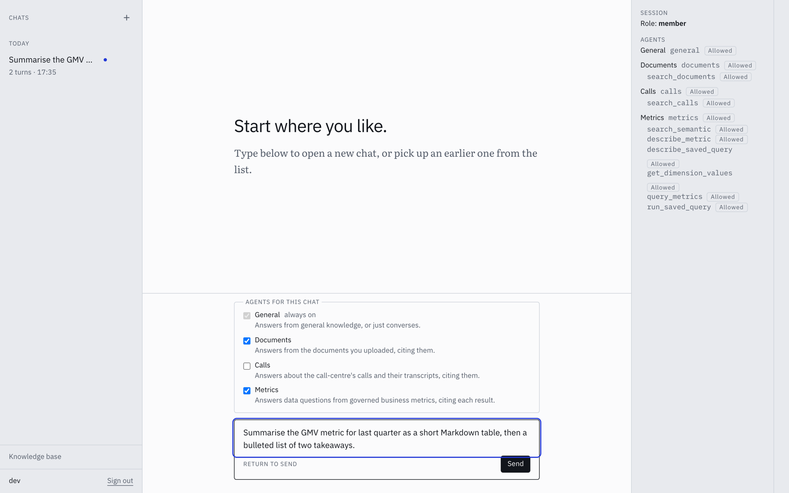
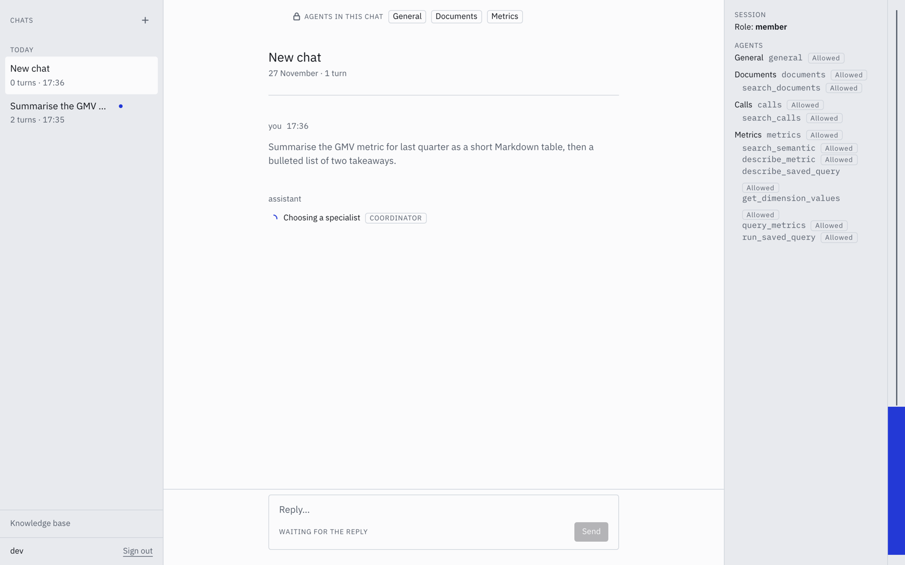
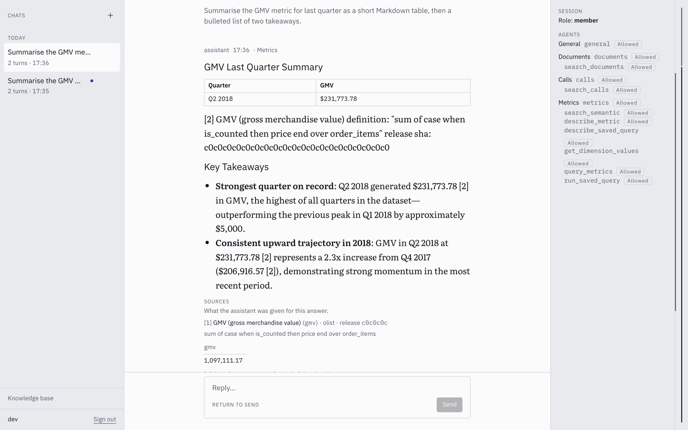
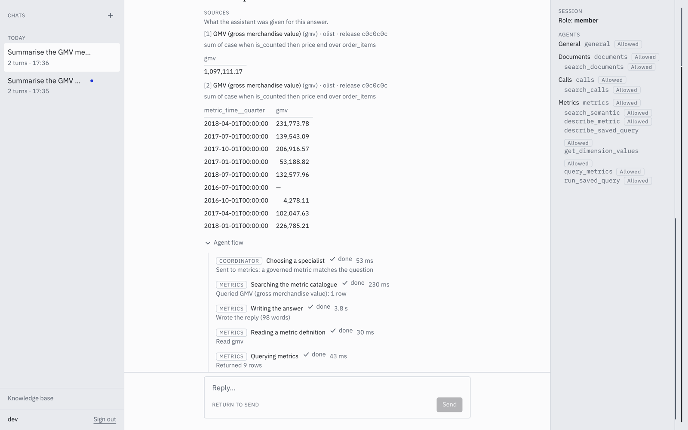
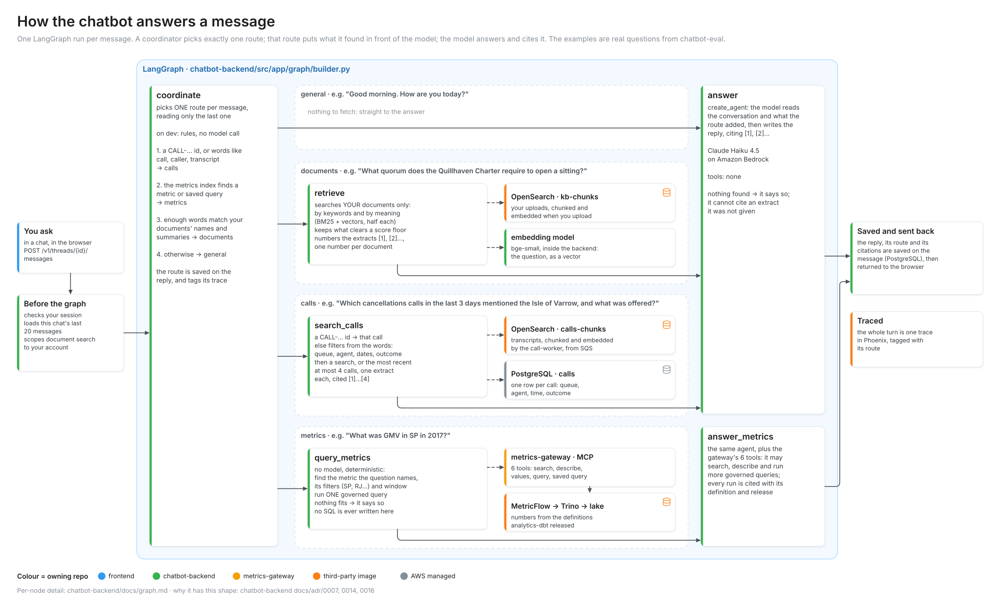
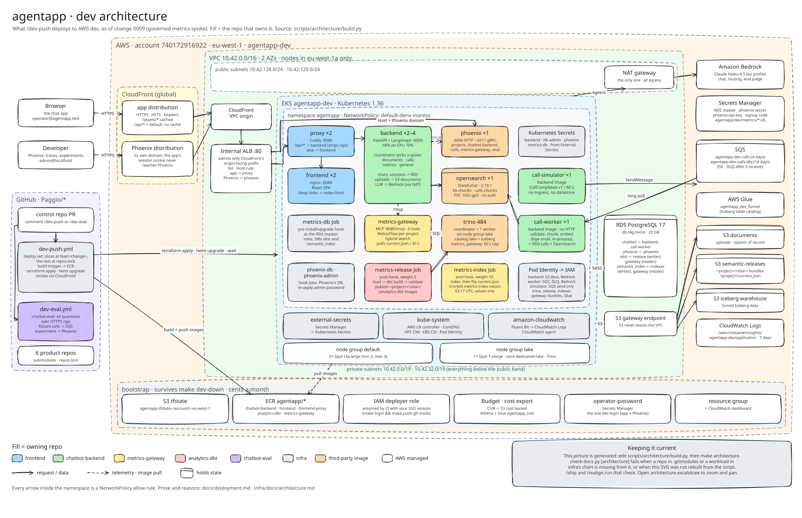
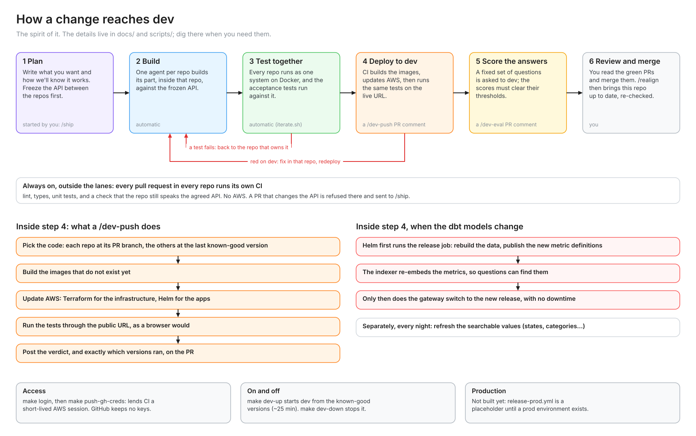
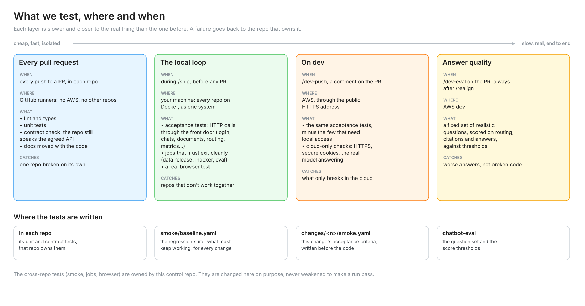
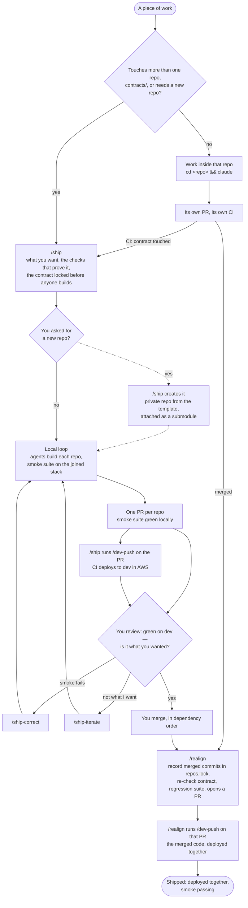

# agent-app-project

The control repo for the product repos, each a git submodule. It owns what no single repo
can: the contracts between them, the cross-repo changes, and the proof they work together.
`dev` is the one AWS environment: CI deploys PRs there, and it costs money while it is up.

## The chatbot

| | |
| --- | --- |
| [](docs/screenshots/1-new-chat-agent-picker.png) | [](docs/screenshots/2-live-progress.png) |
| **Choose the agents** for each chat; `General` is always on. | **Live progress** per step; the chosen agents stay locked and visible. |
| [](docs/screenshots/3-markdown-reply-locked-agents.png) | [](docs/screenshots/4-agent-flow.png) |
| **Markdown answers** with the sources the assistant was given. | **Agent flow**: how the answer was reached, step by step. |

## The agent

[](agent.svg)

## Architecture

[](architecture.svg)

## CI/CD

[](cicd.svg)

## Tests

[](tests.svg)

All four pictures are generated: edit `scripts/diagrams/<name>.py`, then `make diagrams`.
`check-docs.py [diagrams]` fails when one is stale; when the agent leaves out a graph node or
route, or the architecture a repo or a chart workload; and when a workflow, lane, repo CI or
smoke suite appears or disappears that the CI/CD or tests picture was not reviewed against.
Those two stay at the level of intent; the detail is in `docs/deployment.md` and
`docs/adr/0018`. The hand-drawn architecture is kept at tag `diagrams/architecture-sketch-v1`.

## The paths



Around every deploy:

- **Before a lane deploys:** `make login && make push-gh-creds`. This hands CI your
  short-lived AWS session. There are no long-lived keys in GitHub.
- **Signing in to `dev`:** `make -C infra credentials ENV=dev` prints the app and Phoenix
  logins and how to read their one password.
- **While `dev` is up:** comment /dev-eval on any PR deployed to `dev` to run the eval
  against it. Run `make dev-down` when you are done, to bring cost back to near zero.

Merging is always your decision. The dependency order is recorded in the change's
`STATUS.md`: the repo that is backward compatible on its own merges first. If `/realign`
goes red, the failing check names the repo answerable. Fix it there, in a session inside
that repo, then run `/realign` again.

## The repos

| Repo | Contents |
| --- | --- |
| [`chatbot-backend`](https://github.com/Paggio/chatbot-backend) | API service and its hub-and-spoke graph; the call-ingest worker and the call simulator |
| [`chatbot-eval`](https://github.com/Paggio/chatbot-eval) | eval runs: documents and call fixtures, questions per route, Phoenix experiments |
| [`frontend`](https://github.com/Paggio/frontend) | web client and edge proxy |
| [`infra`](https://github.com/Paggio/infra) | Terraform and the Helm chart for `dev` on AWS |
| [`analytics-dbt`](https://github.com/Paggio/analytics-dbt) | Governed metrics as code - dbt and MetricFlow projects over Olist in Postgres and the marketing funnel in Iceberg, and the release bundles they publish. |
| [`metrics-gateway`](https://github.com/Paggio/metrics-gateway) | MCP server that answers data questions only through MetricFlow metrics, with hybrid semantic search over the published release. |

All of them carry the `agent-app-project` topic:
[filter the repo list by it](https://github.com/Paggio?tab=repositories&q=topic%3Aagent-app-project).

```bash
git clone --recurse-submodules git@github.com:Paggio/agent-app-project.git
```

## The lanes

A lane is one slash command in `claude`, run from this repo. Run one lane per session.
`<change>` is the change's directory under `changes/`, e.g. `0007-dev-environment`.

| When | Run |
| --- | --- |
| One repo, no interface change | nothing here: `cd <repo> && claude` |
| Two or more repos, any contract change, or a new repo | `/ship "<what you want>"` — say "new repo" explicitly; it never creates one unasked |
| PRs open, nothing merged, and the result is wrong | `/ship-correct <change>: <what is wrong>` |
| PRs open, nothing merged, and you want something different | `/ship-iterate <change>: <what to change>` |
| PRs have merged | `/realign` |

Each lane ends with a review of the tooling in this repo: its scripts, its commands and its
agent rules. That review may open one PR fixing the tooling.

## Where to read next

- `concept.md` — how the whole system works, and why. The reference.
- `CLAUDE.md` — the rules an agent follows here.
- `docs/adr/` — decisions and their costs. Read these before proposing a redesign.
- `docs/infra-interface.md` — what this repo requires of `infra/`.
- `docs/deployment.md` — the deployed system as diagrams: network, cluster, data flows, deploys.
- `docs/dev-push-caller.md` — how a product repo gets `/dev-push`.
- `make help` — the tools for running and inspecting the joined stack.
