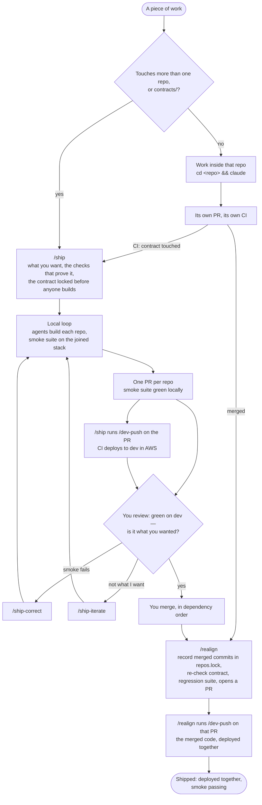

# agent-app-project

The control repo for four product repos, each a git submodule. It owns what no single repo
can: the contracts between them, the cross-repo changes, and the proof they work together.
`dev` is the one AWS environment: CI deploys PRs there, and it costs money while it is up.

## The paths



Around every deploy:

- **Before a lane deploys:** `make login && make push-gh-creds`. This hands CI your
  short-lived AWS session. There are no long-lived keys in GitHub.
- **Signing in to `dev`:** `make -C infra credentials ENV=dev` prints the app and Phoenix
  logins and how to read their one password.
- **While `dev` is up:** comment /dev-eval on any PR deployed to `dev` to run the eval
  against it. Run `make dev-down` when you are done, to bring cost back to near zero.

Merging is always your decision. The dependency order is recorded in the change's
`STATUS.md`: the repo that is backward compatible on its own merges first. If `/realign`
goes red, the failing check names the repo answerable. Fix it there, in a session inside
that repo, then run `/realign` again.

## The repos

| Repo | Contents |
| --- | --- |
| [`chatbot-backend`](https://github.com/Paggio/chatbot-backend) | API service and its hub-and-spoke graph; the call-ingest worker and the call simulator |
| [`chatbot-eval`](https://github.com/Paggio/chatbot-eval) | eval runs: documents and call fixtures, questions per route, Phoenix experiments |
| [`frontend`](https://github.com/Paggio/frontend) | web client and edge proxy |
| [`infra`](https://github.com/Paggio/infra) | Terraform and the Helm chart for `dev` on AWS |

```bash
git clone --recurse-submodules git@github.com:Paggio/agent-app-project.git
```

## The lanes

A lane is one slash command in `claude`, run from this repo. Run one lane per session.
`<change>` is the change's directory under `changes/`, e.g. `0007-dev-environment`.

| When | Run |
| --- | --- |
| One repo, no interface change | nothing here: `cd <repo> && claude` |
| Two or more repos, or any contract change | `/ship "<what you want>"` |
| PRs open, nothing merged, and the result is wrong | `/ship-correct <change>: <what is wrong>` |
| PRs open, nothing merged, and you want something different | `/ship-iterate <change>: <what to change>` |
| PRs have merged | `/realign` |

Each lane ends with a review of the tooling in this repo: its scripts, its commands and its
agent rules. That review may open one PR fixing the tooling.

## Where to read next

- `concept.md` — how the whole system works, and why. The reference.
- `CLAUDE.md` — the rules an agent follows here.
- `docs/adr/` — decisions and their costs. Read these before proposing a redesign.
- `docs/infra-interface.md` — what this repo requires of `infra/`.
- `docs/dev-push-caller.md` — how a product repo gets `/dev-push`.
- `make help` — the tools for running and inspecting the joined stack.
