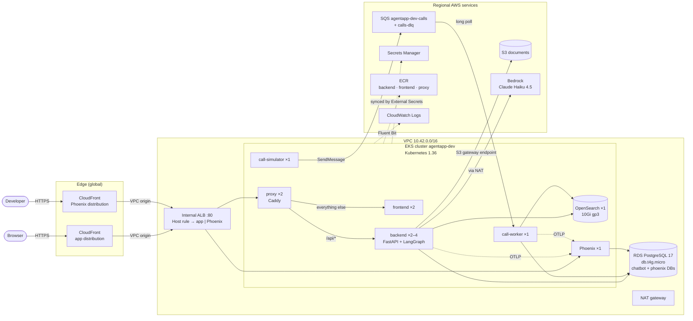
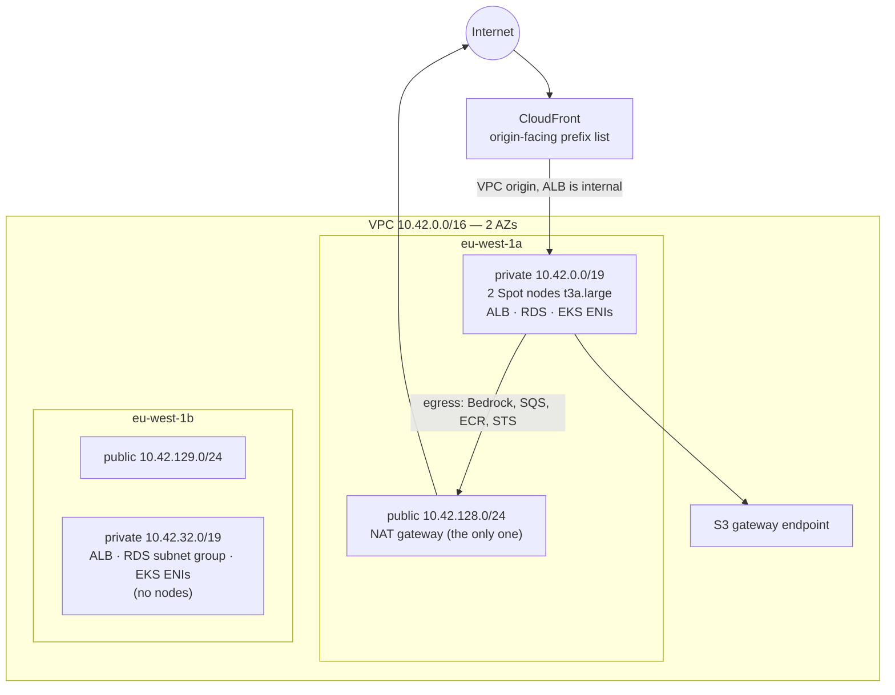
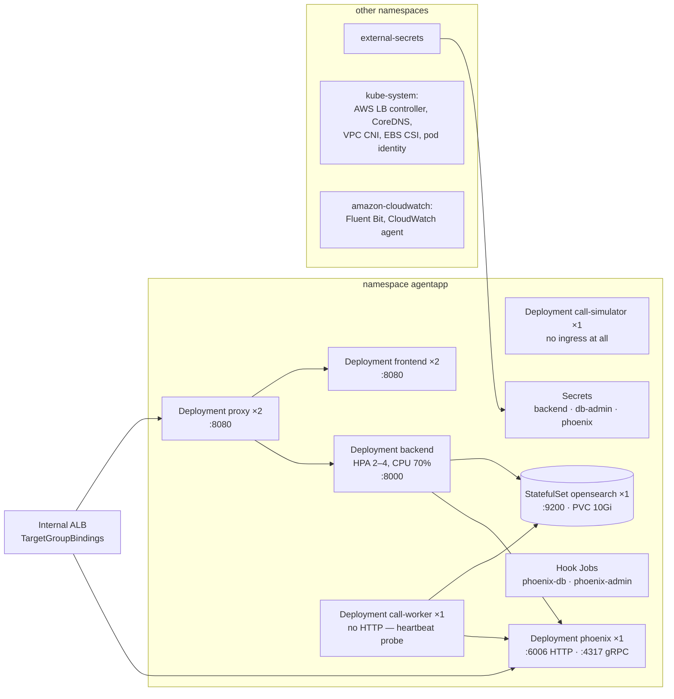
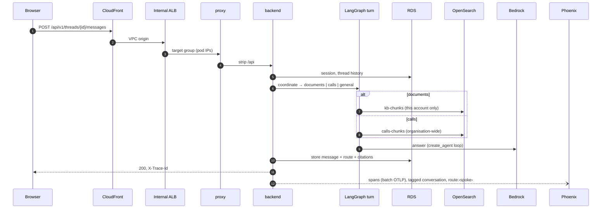
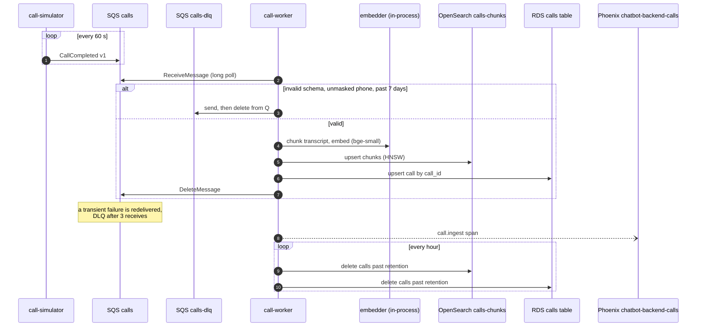
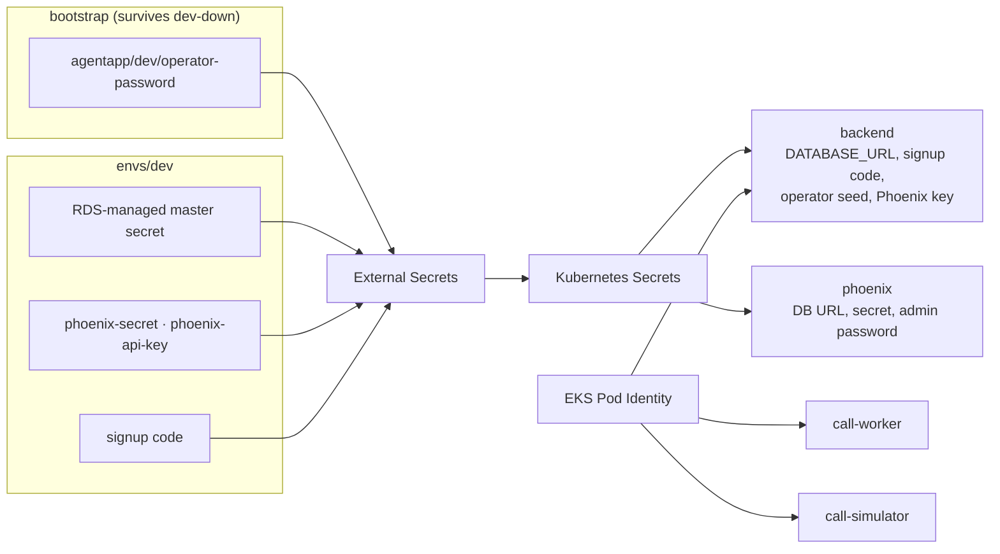
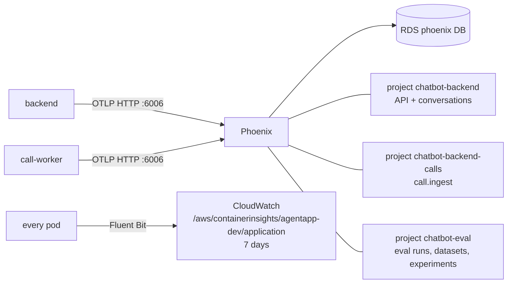

# Deployment architecture

What `dev` runs, as deployed: account `740172916922`, `eu-west-1`. A `prod` would be another
`infra/envs/<env>/` root with the same modules and chart — none exists yet. Owned by `infra/`;
its `docs/architecture.md` is the prose and the reasons, this page is the map.
`check-docs.py [deployment-doc]` fails when a value here disagrees with `infra/`.

## 1. The whole system

## 2. Network

- Nodes are in one AZ on purpose: cheap, and OpenSearch's gp3 volume is zonal.
- One NAT, no interface endpoints: SQS and Bedrock traffic is cents; an endpoint is ~$15/month.
- The ALB admits only CloudFront's origin-facing prefix list; nothing in the VPC is public.

## 3. Inside the cluster

Every arrow inside `agentapp` is a NetworkPolicy allow rule; the default is deny ingress.
OpenSearch has no auth plugin, so its policy is its only access control.

| Workload | Image | Requests → limits | Identity (pod identity → IAM) |
| --- | --- | --- | --- |
| backend | ECR `agentapp/chatbot-backend` | 250m/768Mi → 1/1536Mi | S3 documents, Bedrock |
| call-worker | same image, `python -m app.calls.worker` | 100m/512Mi → 1/1536Mi | SQS receive/delete, DLQ send, Bedrock |
| call-simulator | same image, `python -m app.calls.simulator` | 25m/128Mi → 250m/512Mi | SQS send to the main queue only |
| frontend | ECR `agentapp/frontend` | 25m/32Mi → 200m/128Mi | — |
| proxy | ECR `agentapp/frontend-proxy` | 50m/64Mi → 500m/256Mi | — |
| opensearch | `opensearchproject/opensearch:2.19.1` | 250m/1Gi → 1/1536Mi | — |
| phoenix | `arizephoenix/phoenix:version-20.4.0` | 100m/512Mi → 1/1Gi | — |

## 4. A chat turn

## 5. A call, from producer to answer

Queue retention: main 4 days, DLQ 14. Calls are readable for 7 days after `ended_at`.

## 6. Secrets and identity

The fixed login: `operator@agentapp.test` (app) and `admin@localhost` (Phoenix) share
`operator-password`. `make -C infra credentials ENV=dev SHOW=1` prints it; every
`/dev-push` comment carries it.

## 7. Observability

## 8. How it gets deployed

```mermaid
flowchart LR
  pr["control PR comment<br/>/dev-push"] --> gha["GitHub Actions<br/>dev-push.yml (main's copy)"]
  gha --> set["resolve deploy set<br/>slices at feat/‹change›, rest at repos.lock"]
  set --> build["build + push images<br/>→ ECR"]
  build --> tf["terraform apply<br/>envs/dev"]
  tf --> helm["helm upgrade --install --wait<br/>charts/agentapp"]
  helm --> check["deploy checks<br/>images · target health · both logins"]
  check --> smoke["baseline + change smoke<br/>through CloudFront"]
  smoke --> comment["verdict + deployed commits<br/>+ sign-in, on the PR"]
```

The session CI deploys with is the one `make login && make push-gh-creds` hands it; it
assumes the bootstrap deployer role.

## 9. What survives `make dev-down`

| Survives (bootstrap, cents a month) | Destroyed (envs/dev, ~$0.45 an hour) |
| --- | --- |
| Terraform state bucket | VPC, subnets, NAT, S3 endpoint |
| ECR repositories and their images | EKS cluster, nodes, add-ons, OpenSearch volume |
| Deployer role and its policies | RDS — every account, thread and call is lost |
| Budget, cost export, Athena workgroup | SQS queues, documents bucket |
| `operator-password` | ALB, CloudFront distributions and VPC origin |
| | Secrets Manager secrets of the environment |

## 10. Locally

`make up` runs the same services with Docker Compose on one origin, `http://localhost:8080`.
ElasticMQ stands in for SQS, MinIO for S3, and a postgres container for RDS. Phoenix is at
`:6006` with no login. `stack/compose.yml` joins each repo's own compose file.
